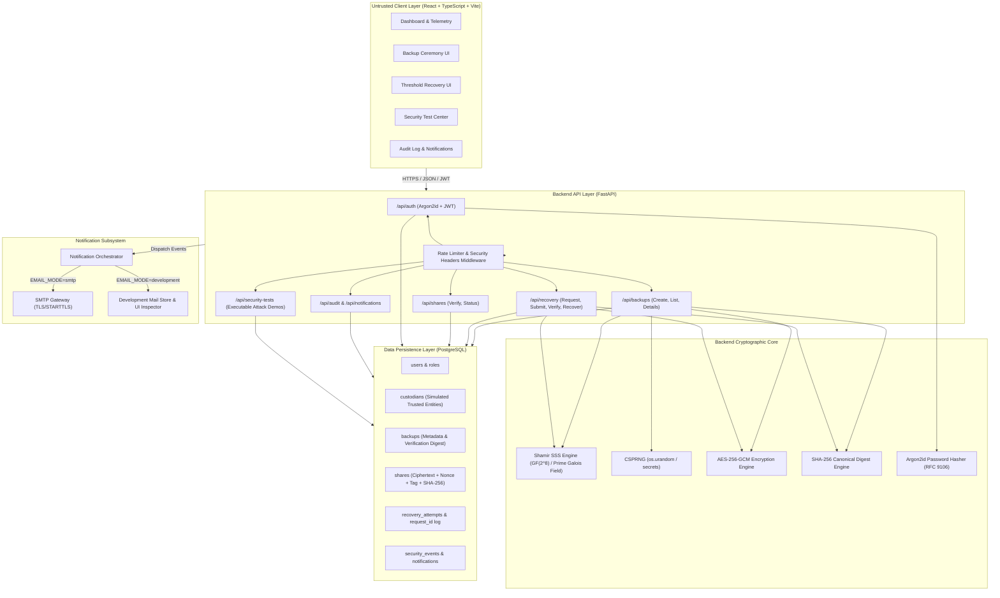
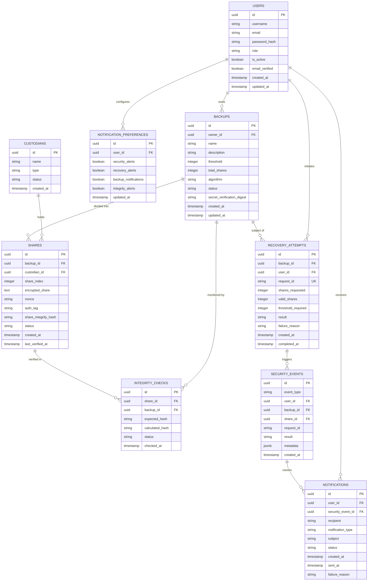
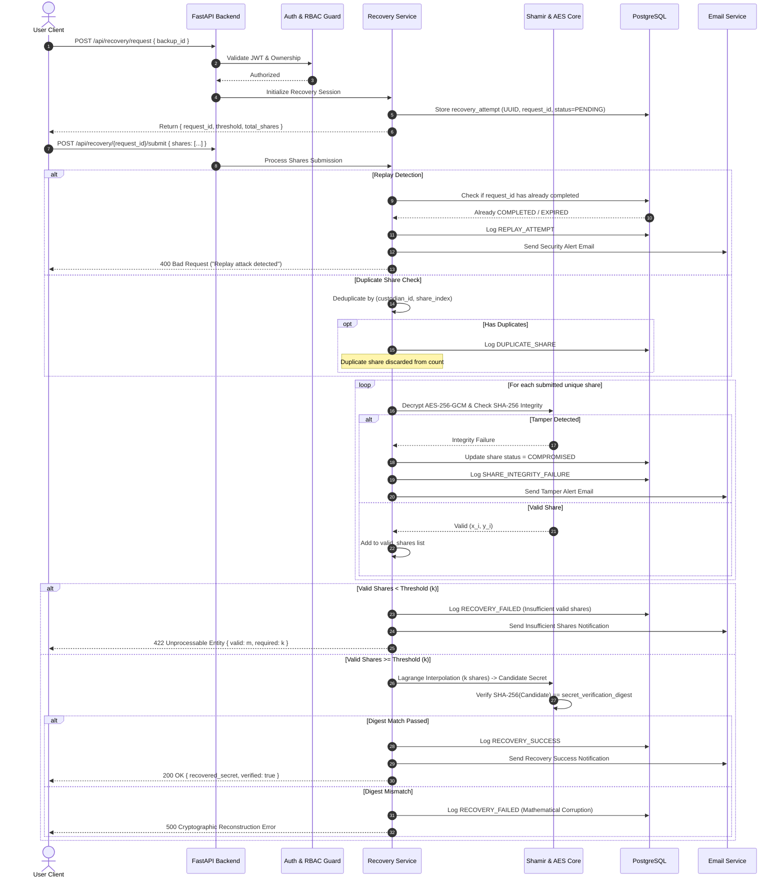

# Project Plan: VaultGuard — Threshold-Cryptography Backup System
**Academic Project Title:** Threshold-Cryptography Backup System  
**Product/UI Name:** VaultGuard  
**Product Tagline:** *Secure Recovery Through Distributed Trust*  
**Course Context:** Applied Cryptography and Network Security (College-Level Prototype)  
**Author / Developer:** Karthikram  
**Advisory & Engineering Guidance:** Senior Applied Cryptography, Cybersecurity & Full-Stack Mentor  
**Date:** October 2026  
**Document Status:** Pending Architecture Approval  

---

## Table of Contents
1. [Executive Summary & Project Purpose](#1-executive-summary--project-purpose)
2. [High-Level System Architecture](#2-high-level-system-architecture)
3. [Technology Stack & Library Selection Rationale](#3-technology-stack--library-selection-rationale)
4. [Cryptographic Design & Mathematical Specifications](#4-cryptographic-design--mathematical-specifications)
5. [Database Architecture & Schema Design](#5-database-architecture--schema-design)
6. [Authentication, Authorization & Session Model](#6-authentication-authorization--session-model)
7. [End-to-End Cryptographic Workflows](#7-end-to-end-cryptographic-workflows)
   - 7.1 Secret Ingestion & Backup Workflow
   - 7.2 Share Verification & Tamper Detection Workflow
   - 7.3 Threshold Recovery Workflow & Attack Countermeasures
8. [Notification & Email Subsystem Architecture](#8-notification--email-subsystem-architecture)
9. [UI/UX Architecture & Page Directory](#9-uiux-architecture--page-directory)
10. [Threat Model & Security Risk Matrix (T1–T10)](#10-threat-model--security-risk-matrix-t1t10)
11. [Security Boundaries, Trust Assumptions & Anti-Theater Policy](#11-security-boundaries-trust-assumptions--anti-theater-policy)
12. [Security Test Center Specifications](#12-security-test-center-specifications)
13. [Academic Novelty, Literature Review & Research Framing](#13-academic-novelty-literature-review--research-framing)
14. [Prototype Limitations & Future Enhancements](#14-prototype-limitations--future-enhancements)
15. [Systematic 16-Phase Implementation Roadmap](#15-systematic-16-phase-implementation-roadmap)
16. [Verification Criteria & Next Steps](#16-verification-criteria--next-steps)

---

## 1. Executive Summary & Project Purpose

### 1.1 Core Mission
The objective of **VaultGuard** is to design, implement, and rigorously evaluate a functional prototype of a threshold-cryptographic backup and recovery system. In modern digital infrastructure, single-point storage of critical cryptographic credentials (e.g., master signing keys, recovery seeds, root certificate private keys) presents an acute operational dilemma:
- **Centralized storage** creates a single point of failure and a high-value target for exfiltration.
- **Physical duplication** multiplies the attack surface across every storage site.

VaultGuard resolves this dilemma using **$(k, n)$ threshold secret sharing**:
1. A sensitive cryptographic secret is split into $n$ distinct polynomial shares.
2. The shares are distributed among $n$ designated custodians (modeled logically in this prototype).
3. Any subset of at least $k$ authorized, uncorrupted shares can reconstruct the original secret ($k \le n$).
4. Any coalition of fewer than $k$ shares reveals **zero information** regarding the underlying secret (information-theoretic security).

### 1.2 Pedagogical & Architectural Guarantees
- **Zero Client Trust:** The frontend is treated as an untrusted rendering layer. All cryptographic splitting, reconstruction, threshold evaluations, integrity validations, and authorization checks are executed exclusively within the backend.
- **No Plaintext Persistence:** The original secret is never written to disk, logged to standard output, stored in the database, or retained in persistent memory.
- **Real Cryptography, Zero Theater:** No synthetic or pseudo-cryptographic operations (e.g., XOR with a single key, Base64 encoding, or simple reversible substitutions) are permitted. All algorithms adhere to NIST and RFC specifications.
- **Dynamic System State:** Dashboards, audit logs, and security verification meters are derived in real time from transactional database queries, not static or simulated front-end mock values.

---

## 2. High-Level System Architecture



### 2.1 Backend Separation of Concerns
The backend will adhere to strict modular isolation:
```text
backend/
├── app/
│   ├── api/                 # Endpoint routers (FastAPI APIRouter)
│   │   ├── auth.py          # Registration, login, session inspection
│   │   ├── backups.py       # Backup creation, retrieval, metadata
│   │   ├── shares.py        # Share inspection, manual verification
│   │   ├── recovery.py      # Multi-step threshold recovery ceremonies
│   │   ├── security_tests.py# Executable attack simulation suite
│   │   ├── audit.py         # Security event querying & export
│   │   └── notifications.py # Notification inbox & preferences
│   ├── core/
│   │   ├── config.py        # Pydantic BaseSettings, env validation
│   │   ├── database.py      # SQLAlchemy engine, session generator
│   │   └── security.py      # JWT encoding/decoding, token extraction
│   ├── crypto/
│   │   ├── shamir.py        # Exact Shamir secret sharing implementation
│   │   ├── aes_gcm.py       # AES-256-GCM authenticated encryption at rest
│   │   ├── hashing.py       # SHA-256 canonical hashing & Argon2id hashing
│   │   └── rng.py           # Cryptographically secure random generators
│   ├── models/              # SQLAlchemy declarative ORM models
│   ├── schemas/             # Pydantic request/response validation schemas
│   ├── services/            # Business and orchestration logic
│   │   ├── backup_service.py
│   │   ├── recovery_service.py
│   │   ├── audit_service.py
│   │   ├── notification_service.py
│   │   └── email_service.py
│   └── main.py              # Application entrypoint, CORS, exception handlers
├── tests/                   # Pytest test suite
│   ├── test_crypto_shamir.py
│   ├── test_crypto_aes.py
│   ├── test_auth.py
│   ├── test_backup_recovery.py
│   ├── test_security_attacks.py
│   └── test_notifications.py
├── requirements.txt
└── .env.example
```

---

## 3. Technology Stack & Library Selection Rationale

| Layer | Selected Technology | Version / Specification | Selection Rationale & Security Assessment |
| :--- | :--- | :--- | :--- |
| **Frontend UI** | React with TypeScript | React 18.x, TypeScript 5.x | Enforces strict static typing across cryptographic representations, share matrices, and state models. |
| **Build Tool** | Vite | Vite 5.x | Ultra-fast HMR, minimal build overhead, native ES modules. |
| **CSS / Styling** | Tailwind CSS | Tailwind 3.x / 4.x | Professional, consistent design tokens for dark enterprise aesthetic without ad-hoc inline styles. |
| **Icons & Visuals** | Lucide React | Latest | Clean, consistent enterprise security iconography. |
| **Backend Framework**| FastAPI (Python) | FastAPI 0.110+ | Asynchronous REST architecture, automatic OpenAPI/Swagger documentation, native Pydantic validation. |
| **Validation Layer** | Pydantic v2 | Pydantic 2.x | High-performance type enforcement, strict schema validation preventing type-coercion vulnerabilities. |
| **ORM & Database** | SQLAlchemy / PostgreSQL | SQLAlchemy 2.0+, PostgreSQL 15+ | Industrial-strength relational integrity, foreign key cascading, transactional ACID compliance. |
| **Secret Sharing** | Finite-Field Shamir | Custom RFC/NIST-aligned or audited `cryptography` primitives | Exact implementation over Galois Field $GF(2^8)$ or 256-bit prime field $\mathbb{F}_p$. Zero floating-point rounding. |
| **Symmetric Encryption**| AES-256-GCM | `cryptography` library (`hazmat.primitives.ciphers.aead`) | Authenticated Encryption with Associated Data (AEAD); guarantees confidentiality and ciphertext authenticity. |
| **Integrity Digest** | SHA-256 | Python standard library `hashlib` | Collision-resistant cryptographic hash for share integrity fingerprinting and secret verification digests. |
| **Password Hashing** | Argon2id | `argon2-cffi` (RFC 9106) | Winner of the Password Hashing Competition; resistant to GPU/ASIC cracking and side-channel timing attacks. |
| **Token Auth** | JWT (HMAC-SHA256) | `pyjwt` with strict algorithm pinning | Stateless, scoped access tokens with explicit `exp` and `sub` validation. |
| **Email Delivery** | Python `smtplib` + Dev Mail Store | STARTTLS / In-Memory Mailbox | Decoupled notification engine supporting real outbound SMTP and local development inspection mode. |
| **Test Framework** | Pytest + HTTPX | Pytest 8.x, pytest-asyncio | Comprehensive testing for cryptographic edge cases, API contract testing, and attack simulation. |

---

## 4. Cryptographic Design & Mathematical Specifications

### 4.1 Shamir's Secret Sharing (SSS)
Let the secret $S$ be encoded as an element of a finite field $\mathbb{F}_q$. To implement a $(k, n)$ threshold scheme:

1. **Polynomial Construction:**
   A polynomial $f(x)$ of degree $k - 1$ is constructed:
   $$f(x) = a_0 + a_1 x + a_2 x^2 + \dots + a_{k-1} x^{k-1} \pmod p$$
   where:
   - $a_0 = S$ (the secret itself constitutes the constant term, evaluated at $x = 0$).
   - The coefficients $a_1, a_2, \dots, a_{k-1}$ are chosen independently and uniformly at random from $\mathbb{F}_q$ using a cryptographically secure random number generator (CSPRNG, `secrets.SystemRandom`).
   - The modulus $p$ is a prime number strictly greater than both $n$ and the maximum field element representing byte blocks, or arithmetic is conducted in the extension field $GF(2^8)$ using standard irreducible polynomial $P(x) = x^8 + x^4 + x^3 + x + 1$ (Rijndael's field).

2. **Share Generation:**
   For $n$ custodians, $n$ distinct non-zero coordinates $x_i \in \{1, 2, \dots, n\}$ are evaluated:
   $$\text{Share}_i = (x_i, f(x_i))$$
   Each share consists of an $x$-coordinate (index) and a $y$-coordinate (field value).

3. **Reconstruction via Lagrange Interpolation:**
   Given any subset of $m$ shares $\{(x_1, y_1), (x_2, y_2), \dots, (x_m, y_m)\}$ where $m \ge k$ and all $x_i$ are pairwise distinct:
   $$f(0) = \sum_{j=1}^m y_j \cdot \ell_j(0) \pmod p$$
   where the Lagrange basis polynomial evaluated at 0 is:
   $$\ell_j(0) = \prod_{\substack{1 \le r \le m \\ r \ne j}} \frac{0 - x_r}{x_j - x_r} = \prod_{\substack{1 \le r \le m \\ r \ne j}} \frac{-x_r}{x_j - x_r} \pmod p$$
   Division is computed as multiplication by the modular multiplicative inverse:
   $$(x_j - x_r)^{-1} \pmod p$$

4. **Information-Theoretic Security Under Incomplete Coalition ($m < k$):**
   If an adversary obtains $m < k$ shares, there are $q^{k-m}$ equally probable polynomials passing through the $m$ points, corresponding to every possible candidate secret in $\mathbb{F}_q$ with identical uniform probability. Thus, incomplete share coalitions provide **zero Shannon information** about $S$.

### 4.2 Authenticated Encryption of Shares at Rest (AES-256-GCM)
Raw shares are **never** stored as plaintext in the database:
- **Key Generation:** A 256-bit symmetric encryption key (`AES_MASTER_KEY`) is provisioned via environment variables (never committed to version control, never written to the database).
- **Nonce/IV:** A cryptographically random 96-bit (12-byte) initialization vector (nonce) is generated per share using `secrets.token_bytes(12)`. Nonces are never reused.
- **Ciphertext & Tag:** The serialized share material $(x_i, y_i)$ is encrypted using AES-GCM, producing ciphertext and a 128-bit authentication tag.
- **Integrity Digest:** Prior to encryption, a canonical SHA-256 hash of the plaintext share coordinate and value is computed and stored alongside the record to enable rapid tamper detection.

### 4.3 Password Hashing (Argon2id)
User authentication strictly enforces Argon2id (RFC 9106):
- Parameter Set: Memory = 64 MB ($65536 \text{ KiB}$), Time Cost = 3 iterations, Parallelism = 1 thread.
- Salt: 16 bytes generated cryptographically per user.
- Resistance: Argon2id combines Argon2d's data-dependent memory access (countering GPU cracking) and Argon2i's data-independent memory access (mitigating side-channel cache attacks).

### 4.4 Cryptographic Verification & Anti-Theater Table

| Component | Legitimate Cryptographic Role | What It Does NOT Provide (Anti-Theater) |
| :--- | :--- | :--- |
| **Shamir SSS** | Threshold-based information splitting and recovery. | Does **NOT** provide confidentiality against an authorized threshold coalition; does **NOT** provide integrity/authenticity of individual shares on its own. |
| **AES-256-GCM** | Confidentiality and ciphertext authenticity for shares stored at rest in the database. | Does **NOT** protect against memory scraping on the backend host while decryption is taking place. |
| **SHA-256** | Integrity verification for detecting bit-level share tampering; non-reversible secret verification digest. | Does **NOT** provide confidentiality; does **NOT** replace salt-hardened password hashing. |
| **Argon2id** | Memory-hard password verification. | Does **NOT** protect against weak, guessable user passwords without minimum entropy enforcement. |
| **JWT** | Stateless authorization token transmission. | Does **NOT** prevent replay if intercepted over non-TLS connections (TLS mandatory in production). |

---

## 5. Database Architecture & Schema Design

PostgreSQL is the system of record. All tables enforce relational integrity, non-nullable foreign keys, and audit timestamps.



---

## 6. Authentication, Authorization & Session Model

### 6.1 Authentication Mechanism
- **Registration:** Users provide username, valid email, and high-entropy password (validated for minimum 10 characters, mixed case, numbers, special characters).
- **Password Storage:** Hashed with Argon2id ($m=65536, t=3, p=1$).
- **Authentication Token:** Upon valid credential presentation, the backend issues a signed JSON Web Token (JWT):
  - Algorithm: `HS256` (pinned explicitly; rejects `none` and asymmetric algorithm confusion).
  - Claims: `sub` (User UUID), `role` (`ADMIN`, `USER`, `CUSTODIAN`), `exp` (30-minute standard expiration), `iat`, `jti` (unique token ID).
- **Session Validation:** Secured FastAPI dependencies (`get_current_user`, `require_role`) intercept incoming requests, validate signatures against `JWT_SECRET_KEY`, check expiration, and confirm user active status in the database.

### 6.2 Role-Based Access Control (RBAC) Matrix

| Endpoint Group / Action | Role: `ADMIN` | Role: `USER` | Role: `CUSTODIAN` | Unauthenticated |
| :--- | :---: | :---: | :---: | :---: |
| **User Registration / Login** | Allowed | Allowed | Allowed | Allowed |
| **View Dashboard Metrics** | Full System Scope | Own Data Scope | Custodian Telemetry | Denied |
| **Create Backup Ceremony** | Allowed | Allowed | Denied | Denied |
| **List Backups** | All Backups | Own Backups Only | Assigned Backups | Denied |
| **Initiate Recovery Ceremony**| Allowed | Own Backups Only | Denied | Denied |
| **Submit Shares for Recovery** | Allowed | Own Backups Only | Authorized Share Only | Denied |
| **Verify Share Integrity** | Full Scope | Own Backups Only | Assigned Share Only | Denied |
| **Simulate Security Attacks** | Allowed | Denied / Demo Sandbox | Denied | Denied |
| **View Audit Logs** | All System Events | Own Events Only | Assigned Events Only | Denied |
| **Configure Custodians** | Allowed | Denied | Denied | Denied |

---

## 7. End-to-End Cryptographic Workflows

### 7.1 Secret Ingestion & Backup Workflow
```text
User Input / CSPRNG Secret 
     │
     ▼
Backend Validation: 1 <= k <= n, valid UTF-8, educational warning confirmed
     │
     ▼
Compute Secret Verification Digest: SHA-256(Secret)  [Stored for post-recovery verification]
     │
     ▼
Shamir SSS Polynomial Generation: f(0)=Secret, degree k-1
     │
     ▼
Evaluate n Shares: {(1, f(1)), (2, f(2)), ..., (n, f(n))}
     │
     ▼
Compute Share Integrity Hashes: SHA-256(Canonical(x_i, y_i))
     │
     ▼
Encrypt Shares at Rest: AES-256-GCM(Key=AES_MASTER_KEY, Nonce=CSPRNG(96), Share_i)
     │
     ▼
Atomic DB Transaction:
  ├── Insert into 'backups' (threshold, total_shares, secret_verification_digest)
  ├── Insert into 'shares' (encrypted_share, nonce, auth_tag, share_integrity_hash)
  ├── Insert into 'security_events' (BACKUP_CREATED, SHARES_GENERATED)
  └── Insert into 'notifications' (BACKUP_CREATED notification queue)
     │
     ▼
Erase Secret from Memory: Overwrite byte buffers, trigger garbage collector
     │
     ▼
Dispatch Email Notification: "VaultGuard: New Backup Created"
     │
     ▼
Return Response: { backup_id, threshold, total_shares, custodian_assignments }
[ORIGINAL SECRET IS NEVER RETURNED IN RESPONSE]
```

### 7.2 Share Verification & Tamper Detection Workflow
To guarantee tamper resilience:
1. When a share verification is triggered (periodically or pre-recovery), the backend fetches the encrypted share, nonce, auth tag, and recorded `share_integrity_hash`.
2. The AES-256-GCM decrypt operation is executed.
   - If the GCM authentication tag verification fails: **Tamper Detected** (Ciphertext manipulated).
3. The canonical representation of $(x_i, y_i)$ is passed through SHA-256.
4. The calculated hash is compared against `share_integrity_hash` using constant-time comparison (`hmac.compare_digest`).
   - If hashes match: Status = `HEALTHY`, update `last_verified_at`.
   - If hashes mismatch: Status = `COMPROMISED`, record `SHARE_INTEGRITY_FAILURE` in `security_events`, record in `integrity_checks`, and dispatch high-priority warning email.

### 7.3 Threshold Recovery Workflow & Attack Countermeasures


---

## 8. Notification & Email Subsystem Architecture

### 8.1 Dual-Mode Delivery Model
The notification engine supports real transactional delivery via SMTP while providing an inspectable development mode to allow verification without external SMTP dependencies:

```text
                               ┌────────────────────────────────┐
                               │     Notification Trigger       │
                               │ (Backup, Recovery, Attack, etc)│
                               └────────────────┬───────────────┘
                                                │
                                                ▼
                               ┌────────────────────────────────┐
                               │   Notification Orchestrator    │
                               │  - Evaluates user preferences  │
                               │  - Sanitizes content           │
                               │  - Records record in DB        │
                               └────────────────┬───────────────┘
                                                │
                       ┌────────────────────────┴────────────────────────┐
                       │                                                 │
          EMAIL_MODE = "smtp"                               EMAIL_MODE = "development"
                       ▼                                                 ▼
        ┌─────────────────────────────┐                  ┌─────────────────────────────┐
        │        SMTP Gateway         │                  │      Local Mail Store       │
        │ - Connects to SMTP_HOST     │                  │ - Stores full message in    │
        │ - Issues STARTTLS           │                  │   database & memory queue   │
        │ - Delivers to real inbox    │                  │ - Exposed to UI Mail Viewer │
        └──────────────┬──────────────┘                  └──────────────┬──────────────┘
                       │                                                 │
             [Real Inbound Box]                                [UI Development Inspector]
```

### 8.2 Mandatory Security Sanitization in Emails
Emails **NEVER** contain:
- The original or recovered secret.
- Plaintext user passwords.
- Raw or decrypted Shamir share material $(x_i, y_i)$.
- Backend cryptographic keys (`AES_MASTER_KEY`, `JWT_SECRET_KEY`).
- Valid authorization bearer tokens.

### 8.3 Supported Email Notification Triggers

| Event Trigger | Severity | Subject Line | Recipient |
| :--- | :--- | :--- | :--- |
| **New Backup Created** | `INFO` | `VaultGuard: New Backup Established — [Backup Name]` | Backup Owner |
| **Recovery Attempt Initiated** | `WARNING` | `VaultGuard Security Alert: Recovery Initiated for [Backup Name]` | Backup Owner |
| **Successful Recovery** | `INFO` | `VaultGuard: Secret Successfully Reconstructed for [Backup Name]` | Backup Owner |
| **Failed Recovery (Threshold Unmet)** | `WARNING` | `VaultGuard Alert: Recovery Failed (Insufficient Valid Shares)` | Backup Owner |
| **Tampered Share Detected** | `CRITICAL` | `VaultGuard Critical Security Alert: Share Integrity Compromised` | Backup Owner + Admins |
| **Invalid / Corrupted Share** | `WARNING` | `VaultGuard Alert: Invalid Share Rejected During Recovery` | Backup Owner |
| **Unauthorized Recovery Attempt** | `CRITICAL` | `VaultGuard Security Alert: Unauthorized Recovery Rejected` | Target Resource Owner |
| **Replay Attack Detected** | `CRITICAL` | `VaultGuard Security Alert: Replay Request Intercepted` | Backup Owner + Admins |
| **Security / Password Changed** | `WARNING` | `VaultGuard Security Notice: Account Password Changed` | User Email |

---

## 9. UI/UX Architecture & Page Directory

The application UI will feature an enterprise security console aesthetic: a deep charcoal and navy color scheme (`#0B0F19`, `#111827`, `#1E293B`), restrained accent hues (emerald green for verified cryptographic states, amber for threshold warnings, crimson for integrity alerts, cobalt for active processes), sharp typography (Inter / JetBrains Mono for cryptographic identifiers), and real-time backend-polled telemetry.

### 9.1 Route Structure & Page Specifications

```text
/                              Landing Page (Product Overview, Architecture Schematic, Quick Demo CTA)
├── /login                     User & Administrator Authentication
├── /register                  New Operator Onboarding with Password Strength Meter
├── /dashboard                 Unified Security Operations Dashboard (Live Metrics, Health %, Feeds)
├── /backups                   Backup Registry (List of Vault Backups, Thresholds, Custodian Mapping)
├── /backups/new               Interactive Backup Creation Ceremony (Secret Input/Gen, SSS Config)
├── /shares                    Custodian Share Repository (Status, Integrity Verification, AES Protection)
├── /recovery                  Threshold Recovery Console (Share Collection, Live Threshold Meter, Release Panel)
├── /security-tests            Security Test Center (Executable Attack Scenarios: Tamper, Replay, etc.)
├── /audit                     Immutable Audit Log Viewer (Filterable Security Event Log, JSON Export)
├── /custodians                Custodian Management Console (Logical Custodian Health & Assignments)
├── /notifications             Security Alert Center (Inbox, Preference Matrix, Development Mail Viewer)
├── /settings                  System Configuration & Operational Parameters
└── /about                     Cryptographic Foundations, Mathematical Model & Academic Citations
```

---

## 10. Threat Model & Security Risk Matrix (T1–T10)

Following NIST SP 800-30 and OWASP Threat Modeling standards:

| ID | Threat Name | Attacker Capability | Attacker Goal | Applied Security Control | Residual Risk |
| :--- | :--- | :--- | :--- | :--- | :--- |
| **T1** | **Database Compromise (Read Access)** | Full read access to PostgreSQL tables via SQLi or dump theft. | Exfiltrate backup secret and reconstruct master credentials. | Shamir shares are encrypted at rest with AES-256-GCM; key is held strictly in backend environment variables. | If the attacker compromises both the database dump and backend OS environment variables, confidentiality is lost. |
| **T2** | **Sub-Threshold Share Exfiltration** | Attacker compromises $m < k$ custodians or database share rows. | Reconstruct or reduce entropy of the master secret. | Information-theoretic security of Shamir's scheme guarantees zero mathematical leakage for $m < k$. | Threat of future compromise of remaining $k - m$ shares remains until secret rotation. |
| **T3** | **Share Tampering / Bit Flipping** | Attacker alters ciphertext or coordinate bytes in database. | Force reconstruction of corrupted secret or crash recovery engine. | AES-256-GCM authentication tag verification and SHA-256 canonical integrity digests detect alteration immediately. | Denial of service on that specific share; recovery requires $k$ remaining healthy shares. |
| **T4** | **Unauthorized Recovery Attempt** | Malicious user without ownership of the target backup initiates recovery. | Gain unauthorized release of another user's secret. | Backend RBAC layer enforces ownership checks on all `/api/recovery/*` operations prior to processing. | Token theft via client endpoint compromise could allow impersonation. |
| **T5** | **Replay Attack** | Interception and resubmission of a previously completed recovery payload. | Force repeated secret release or duplicate audit events. | Ephemeral `request_id` tracked in `recovery_attempts`; marked terminal upon execution. Subsequent attempts rejected as `REPLAY_ATTEMPT`. | Network-level denial of service if flooded with replays (mitigated by rate limiting). |
| **T6** | **Duplicate Share Submission** | User or attacker submits Share 1 multiple times to satisfy threshold $k$. | Bypass threshold $k$ with fewer than $k$ distinct custodian shares. | Backend enforces unique custodian/index set constraints. Duplicates are logged and discarded. | None; mathematical reconstruction strictly requires $k$ distinct coordinates. |
| **T7** | **Malicious Custodian** | A single custodian entity supplies false share material during ceremony. | Prevent valid secret reconstruction. | Pre-computed SHA-256 share verification flags the malicious share before Lagrange interpolation. | If malicious custodians $\ge n - k + 1$, valid threshold cannot be assembled. |
| **T8** | **Backend Host Compromise** | Root access to application server running FastAPI. | Read unencrypted secret in transient memory during split/reconstruction. | Defense-in-depth: immediate buffer overwriting, memory cleanup, no disk swap for secrets. | Inherent limitation: a compromised host kernel can inspect transient process RAM. |
| **T9** | **Stolen Auth Token (JWT Exfiltration)** | XSS or network sniffing captures user bearer token. | Perform operations as the authenticated user. | Short token expiration (30 min), HTTPS enforcement, `SameSite` cookies / secure headers. | Attacker has window of validity until token expires. |
| **T10**| **Low-Entropy User Secret** | User enters easily guessable secret (e.g., "password123"). | Offline dictionary attack if shares or verification hashes are known. | Client and backend entropy validation; prominent educational warning advising random generated keys. | User override in demo mode. |

---

## 11. Security Boundaries, Trust Assumptions & Anti-Theater Policy

### 11.1 Prototype Trust Boundaries
1. **The Client is Completely Untrusted:** All inputs are validated via Pydantic; all cryptographic states are evaluated on the server.
2. **The Database is Untrusted for Plaintext Secrets:** Shares are encrypted at rest with AES-256-GCM.
3. **Simulated Custodians vs. Production MPC:** In this prototype, custodians are modeled as distinct logical entities within the database. While this mirrors the enterprise operational workflow, it does **not** provide the physical hardware security boundary of an independent Multi-Party Computation (MPC) cluster or disparate Hardware Security Modules (HSMs).
4. **Transient RAM Exposure:** During the split and reconstruction ceremonies, the secret resides briefly in Python runtime memory. The prototype aggressively purges references, but does not claim kernel-level memory zeroization.

### 11.2 Strict Anti-Theater Policy
- **No False Encryption Badges:** An element is marked "Encrypted" only if AES-256-GCM ciphertext was produced and stored.
- **No Fake Integrity Checks:** A share is marked "Verified" only after a real SHA-256 hash execution and constant-time equality evaluation.
- **No Synthetic Attack Blocks:** The Security Test Center executes actual backend verification routines that fail due to mathematical or relational constraints.
- **No Fake Email Receipts:** Emails are reported as sent only upon successful SMTP delivery or verified capture in the local development mail queue.

---

## 12. Security Test Center Specifications

The application will feature a dedicated **Security Test Center** providing one-click execution of real attack vectors against the backend cryptographic engine:

```text
┌────────────────────────────────────────────────────────────────────────────────────────┐
│                               VAULTGUARD SECURITY TEST CENTER                          │
├────────────────────────────────────────────────────────────────────────────────────────┤
│ Test 1: Sub-Threshold Share Coalition (2 of 5 Shares)                                 │
│   • Action: Submit only 2 valid shares for a 3-of-5 backup.                           │
│   • Expected Result: 422 Unprocessable Entity ("Threshold not satisfied: 2/3")        │
│   • Event Logged: RECOVERY_FAILED, INSUFFICIENT_SHARES                                │
├────────────────────────────────────────────────────────────────────────────────────────┤
│ Test 2: Valid Threshold Recovery (3 of 5 Shares)                                      │
│   • Action: Submit 3 valid custodian shares.                                          │
│   • Expected Result: 200 OK (Secret reconstructed and SHA-256 digest verified)        │
│   • Event Logged: RECOVERY_SUCCESS                                                    │
├────────────────────────────────────────────────────────────────────────────────────────┤
│ Test 3: Tampered Share Detection (Bit-Flipping in Ciphertext/Share)                   │
│   • Action: Submit 3 shares where 1 share has a corrupted coordinate/ciphertext.       │
│   • Expected Result: 400 Bad Request ("Share integrity verification failed")          │
│   • Event Logged: SHARE_INTEGRITY_FAILURE, TAMPER_ALERT_DISPATCHED                    │
├────────────────────────────────────────────────────────────────────────────────────────┤
│ Test 4: Duplicate Share Submission (Sybil Attempt)                                    │
│   • Action: Submit Share 1, Share 1, and Share 2.                                     │
│   • Expected Result: Rejection of duplicate; valid unique shares = 2 < 3 -> REJECTED  │
│   • Event Logged: DUPLICATE_SHARE, RECOVERY_FAILED                                    │
├────────────────────────────────────────────────────────────────────────────────────────┤
│ Test 5: Unauthorized Recovery Attempt (IDOR Simulation)                               │
│   • Action: User B submits recovery request for User A's private backup.               │
│   • Expected Result: 403 Forbidden ("Access denied to target backup")                 │
│   • Event Logged: UNAUTHORIZED_ATTEMPT                                                │
├────────────────────────────────────────────────────────────────────────────────────────┤
│ Test 6: Replay Request Attack                                                         │
│   • Action: Resubmit a previously completed recovery session `request_id`.            │
│   • Expected Result: 400 Bad Request ("Replay attempt: Request ID already finalized") │
│   • Event Logged: REPLAY_ATTEMPT                                                      │
├────────────────────────────────────────────────────────────────────────────────────────┤
│ Test 7: Cross-Backup / Corrupted Share Injection                                      │
│   • Action: Submit a share belonging to Backup Y into a recovery session for Backup X.│
│   • Expected Result: 400 Bad Request ("Foreign share identifier rejected")            │
│   • Event Logged: INVALID_SHARE                                                       │
└────────────────────────────────────────────────────────────────────────────────────────┘
```

---

## 13. Academic Novelty, Literature Review & Research Framing

### 13.1 Grounding in Established Cryptographic Literature
- **Adi Shamir (1979):** *"How to Share a Secret"*, Communications of the ACM. Established polynomial interpolation over finite fields for $(k, n)$ threshold secret sharing.
- **George Blakley (1979):** *"Safeguarding Cryptographic Keys"*, AFIPS. Introduced geometric hyperplane secret sharing.
- **Paul Feldman (1987) & Torben Pedersen (1991):** Non-interactive Verifiable Secret Sharing (VSS). Demonstrated cryptographic commitments for detecting malicious dealers.
- **NIST SP 800-57 Part 1 Rev. 5:** Recommendations for Key Management, addressing key backup, custodian segregation, and threshold recovery.

### 13.2 Defensible Academic Contribution Statement
The proposed contribution of this project is **not** the invention of an unproven cryptographic primitive, but rather:

> *"An integrated, interactive threshold-cryptographic backup and recovery framework that combines established Shamir Secret Sharing with authenticated share encryption at rest (AES-256-GCM), pre-interpolation canonical integrity verification (SHA-256), strict role-based access control, cryptographic replay and Sybil mitigation, dynamic event auditing, and dual-mode security notifications within a fully verifiable experimental evaluation testbed."*

---

## 14. Prototype Limitations & Future Enhancements

### 14.1 Known Prototype Limitations
1. **Logical vs. Physical Custodian Segregation:** Custodians are modeled within relational database rows rather than physically isolated network hosts.
2. **Single Host Trust Boundary:** A root compromise of the FastAPI application server compromises transient memory.
3. **Absence of Dedicated HSM / Cloud KMS:** Master AES keys are managed via OS environment variables rather than PKCS#11 hardware security modules.
4. **Client-Side Secret Display:** Upon successful recovery, the secret is displayed in the browser DOM (in a controlled, maskable panel), introducing potential exposure to client-side screen scrapers or browser extensions.

### 14.2 Future Research & Engineering Roadmap
- Transition from simulated custodians to independent gRPC microservices running in isolated Docker containers.
- Integration of Verifiable Secret Sharing (Pedersen commitments) to verify shares without decrypting them.
- Hardware key enrollment using FIDO2 / WebAuthn for custodian authorization.
- Automated threshold secret resharing / rotation without altering the underlying secret.

---

## 15. Systematic 16-Phase Implementation Roadmap

In accordance with strict pair-programming standards, the project will proceed through 16 structured phases. **Each phase requires testing, verification, and user approval before proceeding.**

```text
PHASE 0: Workspace Inspection & Architectural Alignment (Current Phase)
  ├── Inspect local directories and tool availability.
  ├── Establish PROJECT_PLAN.md.
  └── Await user confirmation.

PHASE 1: Project Skeleton & Environment Configuration
  ├── Initialize backend directory structure and virtual environment.
  ├── Initialize frontend Vite + React + TypeScript + Tailwind workspace.
  └── Configure environment variable schemas (.env.example).

PHASE 2: Professional UI Shell & Route Navigation
  ├── Implement dark enterprise theme, layout components, and navigation bar.
  ├── Establish route shells with clear mock-data indicators.
  └── Verify responsive design and accessible typography.

PHASE 3: Authentication & User Management
  ├── Backend: Argon2id password hashing and JWT token issuance.
  ├── Frontend: Login, registration, token persistence, and route protection.
  └── Verification: Token expiration, bad password rejection, authenticated endpoints.

PHASE 4: Relational Database Models & Migrations
  ├── Define SQLAlchemy 2.0 declarative models for all 10 normalized tables.
  ├── Seed initial logical custodians and system roles.
  └── Verification: Database connectivity and relational constraints.

PHASE 5: Shamir Secret Sharing Cryptographic Service
  ├── Implement exact finite-field polynomial math (Galois Field / modular prime arithmetic).
  ├── Implement dynamic (k, n) splitting and Lagrange reconstruction.
  └── Verification: Pytest suite validating 2-of-3, 3-of-5, 4-of-7, and 5-of-8 configurations.

PHASE 6: Share Encryption & Integrity Subsystem
  ├── Implement AES-256-GCM encryption/decryption with CSPRNG nonces.
  ├── Implement SHA-256 canonical share hashing for tamper detection.
  └── Verification: Bit-flip detection tests and AEAD tag mismatch tests.

PHASE 7: End-to-End Backup Workflow
  ├── Ingest secret (user-provided or CSPRNG-generated).
  ├── Split, hash, encrypt, and persist shares in database transaction.
  └── Verification: Verify that the raw secret is never written to disk.

PHASE 8: Threshold Recovery Workflow
  ├── Implement recovery session requests, unique request_id generation.
  ├── Enforce deduplication, integrity validation, and threshold verification.
  └── Verification: Reconstruct secret from valid subset; reject sub-threshold submissions.

PHASE 9: Security Test Center
  ├── Build backend endpoints executing 7 real attack simulations.
  ├── Build interactive UI panel showing real-time attack results.
  └── Verification: Execute each attack vector and confirm proper rejection.

PHASE 10: Immutable Audit Logging Subsystem
  ├── Record all security-relevant actions to 'security_events'.
  ├── Build frontend Audit Log viewer with filtering and export.
  └── Verification: Ensure no sensitive secrets or keys are logged.

PHASE 11: Real & Development Email Notification System
  ├── Implement email engine supporting SMTP (TLS) and local dev mailbox capture.
  ├── Connect email dispatch to all 10 security trigger events.
  └── Verification: Inspect captured emails in UI; verify zero secret leakage in email bodies.

PHASE 12: Dynamic Security Operations Dashboard
  ├── Replace all placeholder telemetry with live database aggregations.
  ├── Display backup counts, share health percentages, and recovery metrics.
  └── Verification: Confirm instant metric updates following backup or attack events.

PHASE 13: Comprehensive Automated Testing Suite
  ├── Implement unit, cryptographic, integration, and API tests.
  └── Verification: Ensure 100% pass rate across all security-critical test suites.

PHASE 14: Security Hardening & Penetration Review
  ├── Enforce CORS, security headers, rate limiting, and strict input validation.
  └── Verification: Perform vulnerability scans and audit token lifecycles.

PHASE 15: Experimental Benchmarking & Performance Data
  ├── Measure latency for split, encryption, integrity check, and reconstruction.
  ├── Collect performance metrics across varying (k, n) configurations.
  └── Export reproducible benchmark data.

PHASE 16: Academic Documentation & Final Demonstration
  ├── Produce comprehensive documentation: README.md, ARCHITECTURE.md, THREAT_MODEL.md,
      SECURITY.md, CRYPTOGRAPHY.md, API.md, TESTING.md, LIMITATIONS.md, RESEARCH_AND_NOVELTY.md.
  └── Final end-to-end demonstration verification.
```

---

## 16. Verification Criteria & Next Steps

### 16.1 Criteria for Phase 0 Completion
- [x] Workspace inspected: Confirmed `c:\Users\KARTHIKRAM\OneDrive\Desktop\University Projects\VaultGaurd` is initialized and ready.
- [x] Runtime environments verified: Python 3.14.0 is available; package installation pipeline configured.
- [x] Comprehensive architectural blueprint formulated in `PROJECT_PLAN.md`.
- [ ] User review and explicit approval of `PROJECT_PLAN.md`.

### 16.2 Explicit Stop Gate
In strict adherence to project development rules:
1. No application code has been generated prematurely.
2. The complete architecture, cryptographic specifications, database design, threat model, and development roadmap are documented above.
3. Execution is paused awaiting your review, questions, or explicit approval to commence **PHASE 1**.
